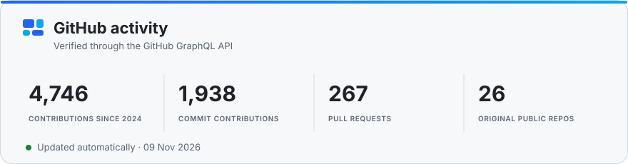
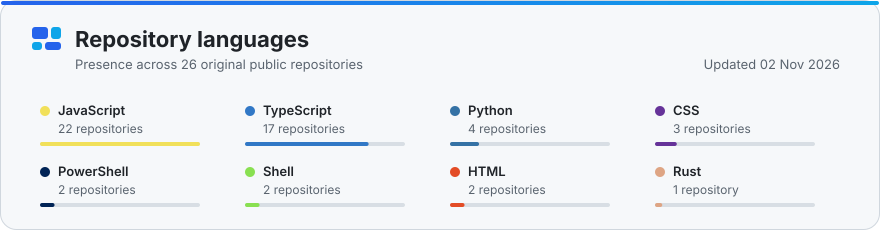

<picture>
  <source media="(prefers-color-scheme: dark)" srcset="https://raw.githubusercontent.com/TheStreamCode/TheStreamCode/main/assets/header-dark.svg">
  
</picture>

# Michael Gasperini

Independent developer. I build open-source tooling for AI coding agents, editor extensions and
local-first applications. I also run [Mikesoft](https://mikesoft.it), the studio where I build
websites and web applications for clients in Italy.

I maintain nine VS Code extensions, with more than 57,000 downloads on Open VSX and 5,800
installs on the Visual Studio Marketplace, and I founded
[Vibe Coding Italia](https://www.vibecodingitalia.org), an Italian AI-coding community with
2,000+ members.

## Open source

- **AI coding agents and model providers**: CLI launchers, MCP servers and provider plugins for
  tools such as Claude Code, Codex, GitHub Copilot, opencode and OpenClaw.
- **Editor extensions**: VS Code tooling that puts agents and terminals one click away.
- **Product engineering**: WordPress and Android projects, built with privacy-first and
  offline-first defaults.

## Client work

Websites, web applications, technical SEO and automation for Italian businesses, through
[Mikesoft](https://mikesoft.it).

## Selected work

| Project | What it does | Reach |
| --- | --- | --- |
| [super-cli](https://github.com/TheStreamCode/super-cli) | One VS Code sidebar and terminal for more than 30 coding agents | 10,500+ [Open VSX](https://open-vsx.org/extension/mikesoft/vscode-super-cli) downloads |
| [chutes-build](https://github.com/TheStreamCode/chutes-build) | Privacy-first coding agent for the Chutes ecosystem, with no telemetry and no self-update | 3,000+ npm downloads per month |
| [chutes-media-mcp](https://github.com/TheStreamCode/chutes-media-mcp) | MCP server and CLI for image, video, music and speech generation | 400+ npm downloads per month |
| [mikesoft-teamvault](https://github.com/TheStreamCode/mikesoft-teamvault) | Private document management for WordPress with granular permissions and audit logs | 40+ active installs on [WordPress.org](https://wordpress.org/plugins/mikesoft-teamvault/) |
| [opencode-muse-auth](https://github.com/TheStreamCode/opencode-muse-auth) | Muse Code authentication and model access for opencode | 1,500+ npm downloads per month |
| [keysoft](https://github.com/TheStreamCode/keysoft) | Offline-first password manager for Android, with no accounts and no cloud | On [Google Play](https://play.google.com/store/apps/details?id=it.mikesoft.keysoft) |

## Stack

TypeScript and Node.js, Rust for CLI tooling, PHP and WordPress, React Native, Astro and Next.js.

## Activity

Refreshed every Monday.

<picture>
  <source media="(prefers-color-scheme: dark)" srcset="https://raw.githubusercontent.com/TheStreamCode/TheStreamCode/profile-stats/profile/activity-dark.svg">
  
</picture>

<picture>
  <source media="(prefers-color-scheme: dark)" srcset="https://raw.githubusercontent.com/TheStreamCode/TheStreamCode/profile-stats/profile/languages-dark.svg">
  
</picture>

## Support

Everything I publish here is open source. Sponsorship pays for the unglamorous part: issue triage,
compatibility updates, documentation and steady releases. Monthly tiers start at 5 USD, and there is
a one-time option if a project saved you some time.

Not in a position to sponsor? A star, a clear issue or a documentation fix helps just as much.

## Contact

- Email: [michael@mikesoft.it](mailto:michael@mikesoft.it)
- LinkedIn: [linkedin.com/in/thestreamcode](https://www.linkedin.com/in/thestreamcode)
- X: [@TheStreamCode](https://x.com/TheStreamCode)
- Studio: [mikesoft.it](https://mikesoft.it)
- All repositories: [github.com/TheStreamCode?tab=repositories](https://github.com/TheStreamCode?tab=repositories)

Available for full-time remote roles, contract work and consulting.

---

Maintained by [Michael Gasperini (Mikesoft)](https://mikesoft.it).
